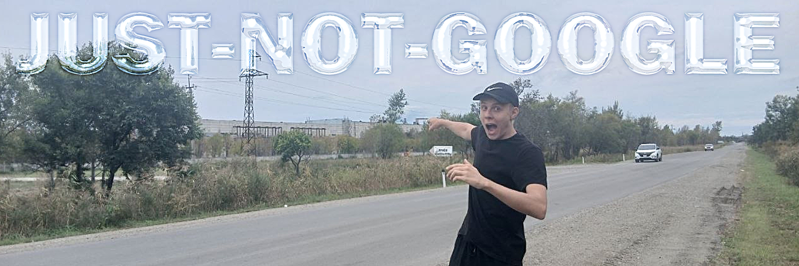

  

> **Not Google, but I also help people find what they are looking for, without the noise.**

## About Me

I am a developer who believes complexity is not a synonym for quality. I like to make things simple, clear, and a little ironic. In a world where everyone and their dog is building an AI startup on their knees, I prefer to create things that actually solve problems. Even if it does not sound like a revolutionary breakthrough.

I stand for clean code, clear thinking, and a sense of humor. I care about tools that respect the user, the machine, and the person who has to read the code six months later. I like small projects that do one thing well. I like local software that works without asking for permission from a distant server. I like ideas that can be explained without a marketing department.

## What I Believe

* Simplicity is a feature.
* Clarity is kindness.
* Local first is a good default.
* Open source is a way to learn in public.

## My Philosophy

* **Simplicity over coolness.** If you can explain a tool in 30 seconds, it is good.
* **Irony helps keep you sane.** In development, as in life, it is important to stay light.
* **Local AI matters.** I like models that run on your own machine, respect your privacy.
* **Python is a good home.** It is readable, practical, and full of kind people.

## A Small Manifesto

Not everything needs to be a startup. Not everything needs to be a platform. Not everything needs to be disruptive. Some things just need to work. Some things just need to be clear. Some things just need to help one person finish one task. That is enough.

> *"Not all heroes wear capes. Some just do not work at Google."*

© 2026 just-not-google
